# MO-Playground

**Massively Parallelized Multi-Objective Reinforcement Learning for Robotics**

Neil Janwani, Ellen Novoseller, Vernon J. Lawhern, Maegan Tucker

Published in *IEEE Robotics and Automation Letters* (RA-L), 2026.

[Paper](https://doi.org/10.1109/LRA.2026.3700381) ·
[arXiv](https://arxiv.org/abs/2603.09237v1) ·
[Project page](https://dynamicmobility.github.io/moplayground/) ·
[Documentation](https://dynamicmobility.github.io/moplayground/documentation/)

## Environments

Learned Pareto fronts, and policies at the two extreme tradeoffs.

| Pareto front | Objective 1 | Objective 2 |
| --- | --- | --- |
| 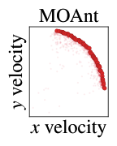 | 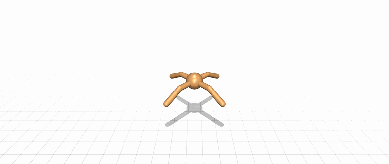 | 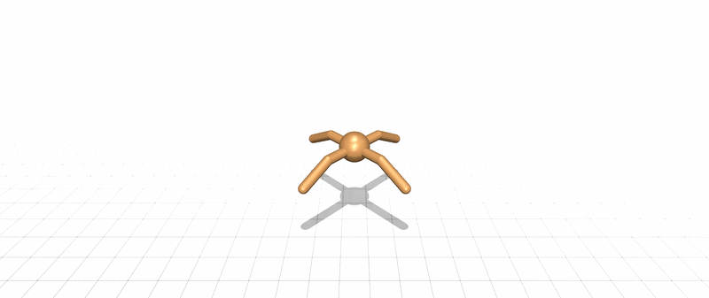 |
| 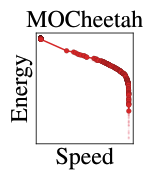 | 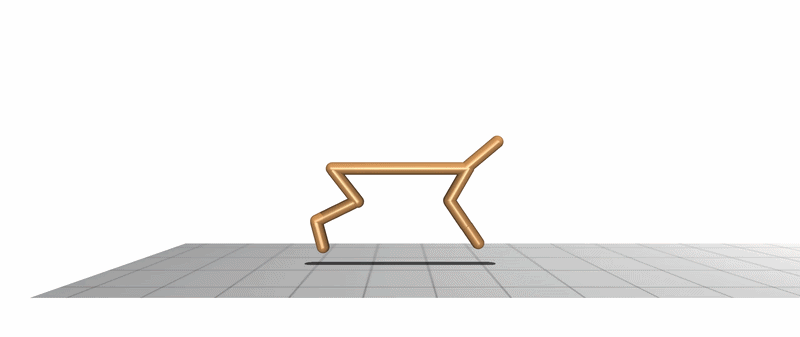 |  |
| 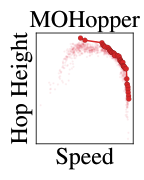 | 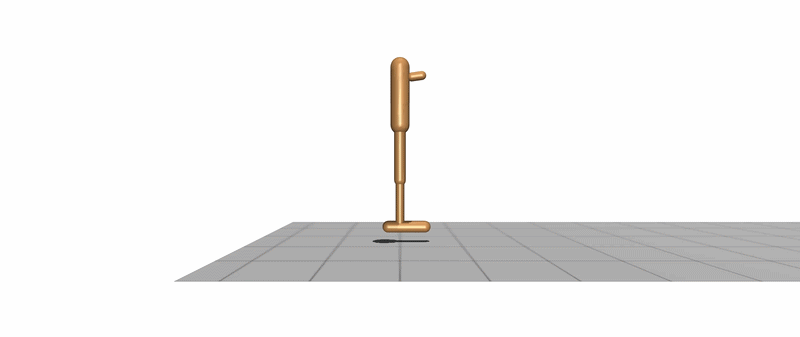 | 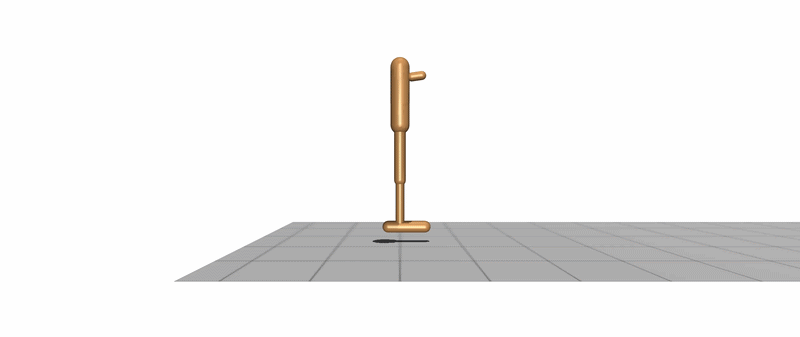 |
| 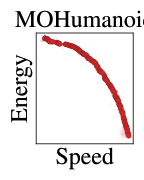 |  |  |
| 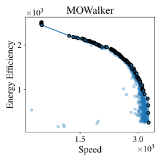 | 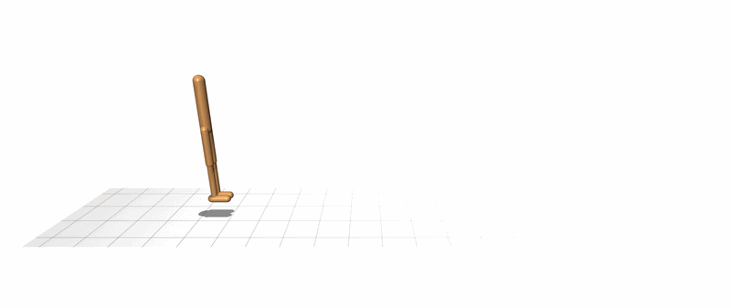 |  |

### BRUCE humanoid

Policies for the [BRUCE](https://www.westwoodrobotics.io/bruce/) humanoid, trained
across six objectives: joint tracking, base tracking, arm swinging, rigid arms,
smoothness and energy efficiency.

| Balanced | Max imitation | Max arm swinging | Max smoothness |
| --- | --- | --- | --- |
| 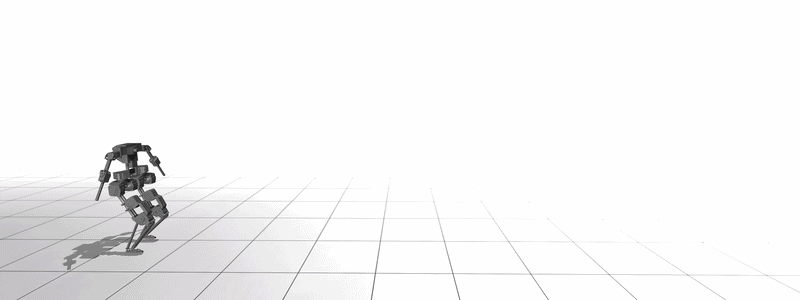 | 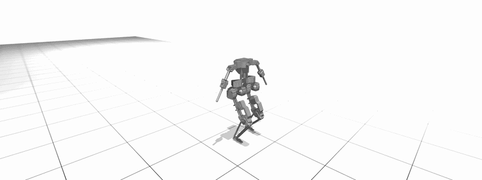 | 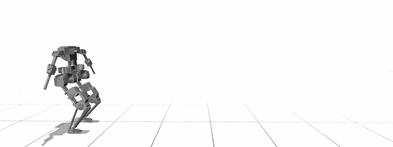 | 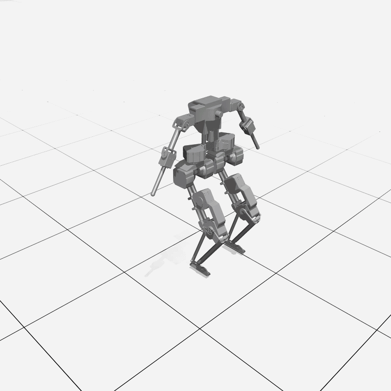 |

## Overview

MO-Playground provides GPU-accelerated multi-objective environments and trainers
built on [MuJoCo Playground](https://github.com/google-deepmind/mujoco_playground),
[Brax](https://github.com/google/brax) PPO and
[minimal_mjx](https://github.com/dynamicmobility/minimal-mjx). A single training run
learns policies for a whole Pareto front of objective tradeoffs:

- **Vector rewards.** Environments return named reward terms. The config groups them
  into objectives, so one environment can be trained on different objective sets
  without code changes.
- **Three algorithms**, selected by `algorithm:` in the config:
  **MORLAX** (a hypernetwork maps the tradeoff to policy and value weights),
  **AMOR** (the tradeoff is an input to the policy and value networks), and
  single-objective **PPO** on a fixed scalarization.
- **Swappable backend.** Environments run on JAX/MJX (`jnp`) for parallel training,
  or on NumPy/C MuJoCo (`np`) for fast, debuggable rollouts.
- **Config-agnostic library.** Library functions take plain arguments.
  `mop.MOConfig` is the only code that knows the YAML layout.

## Install

```bash
pip install moplayground            # from PyPI
```

To train on a GPU, or to work on the code, install from source:

```bash
conda env create -f environment.yml          # Linux / CUDA (mac_environment.yml on macOS)
conda activate moplayground
pip install -e ".[dev]"                      # with pytest
```

Training was tested on Ubuntu 22.04 with Python 3.12 and CUDA 13. Rollouts and
evaluation run on the CPU.

## Repository layout

```
src/moplayground/
  envs/generic/mobase.py  MultiObjectiveBase: groups named reward terms into a reward vector
  envs/dmcontrol/         MOCheetah, MOHopper, MOWalker, MOAnt, MOHumanoid
  envs/locomotion/        NaviGait and the BRUCE humanoid
  envs/create.py          create_environment(): maps a config's env name to a class
  moppo/morlax.py         MORLAX trainer (hypernetwork)
  moppo/amor.py           AMOR trainer (tradeoff-conditioned networks)
  moppo/                  shared losses, network factories, unrolls and evaluation
  learning/training.py    setup_morlax(), setup_amor(): plug the trainers into mm.train
  learning/inference.py   load_mo_policy(): load a checkpoint at a chosen tradeoff
  eval/pareto.py          batched rollouts over many tradeoffs to compute Pareto fronts
  utils/config.py         MOConfig (the only YAML-aware code)
  utils/pareto.py         non-dominated sorting, hypervolume, sparsity
scripts/                  train, rollout, tune (W&B sweeps), download_model, draw_frontier
config/                   one config per environment (AMOR variants in config/amor/)
tests/                    pytest suite
```

## Quick start

Run each script from the repository root and pass a config as its argument:

```bash
python -m scripts.train   config/mocheetah.yaml                         # checkpoints in <save_dir>/<name>/
python -m scripts.rollout <save_dir>/<name>/config.yaml --tradeoff 1 0 0  # roll out at a chosen tradeoff
python -m scripts.rollout config/mocheetah.yaml --inference_fn zero     # dummy controller, no checkpoint
```

To try a pre-trained policy, download it from Weights & Biases and roll it out:

```bash
python -m scripts.download_model --env cheetah                          # saves to results/wandb-downloads/cheetah/
python -m scripts.rollout results/wandb-downloads/cheetah/config.yaml
```

Rollouts use the config's `backend` (`np` is fastest for one environment); training
always uses `jnp`. To roll out an older run, pass the `config.yaml` saved in its run
directory. Its `git_hash` records the commit the run was trained at.

## Writing your own environment

Subclass `mop.MultiObjectiveBase` and implement `reset`, `step`, `reward_function`,
`_get_obs` and `action_size`, using the backend handles (`self._np`, `self._step_fn`,
`self._data_init_fn`, ...) instead of `np`/`jnp` directly. `reward_function` returns a
dict `{name: value}`; the config's `reward.optimization.objectives` decides which terms
form each objective. Register the class in `envs/create.py`. See
[Writing an environment](https://dynamicmobility.github.io/moplayground/documentation/guides/environment/).

## Using the API directly

```python
import jax
import numpy as np
import minimal_mjx as mm
import moplayground as mop

cfg = mop.MOConfig('config/mocheetah.yaml')    # cfg.env_name, cfg.env_params, cfg.run_dir, ...
env, _ = mop.create_environment(cfg.env_name, cfg.env_params, backend='np')

policy = mop.load_mo_policy(
    algorithm      = cfg.algorithm,
    network_params = cfg.morlax_network_params,
    num_objectives = cfg.num_objectives,
    run_dir        = cfg.run_dir,
    tradeoff       = np.array([0.5, 0.3, 0.2]),
)
frames, traj, rewards, data, info = mm.rollout_policy(jax.jit(policy), env, n_steps=500)
mm.save_video(frames, env.dt, 'videos/rollout.mp4')
```

## Tests

```bash
pytest              # fast tier: CPU-only unit tests (~40 s)
pytest -m gpu       # GPU tier: trains tiny MORLAX, AMOR and PPO runs end to end (~4 min)
```

## Citation

```bibtex
@ARTICLE{moplayground,
  author={Janwani, Neil and Novoseller, Ellen and Lawhern, Vernon J. and Tucker, Maegan},
  journal={IEEE Robotics and Automation Letters},
  title={MO-Playground: Massively Parallelized Multi-Objective Reinforcement Learning for Robotics},
  year={2026},
  volume={11},
  number={8},
  pages={9431-9438},
  keywords={Algorithms;International trade;Learning (artificial intelligence);Optimization;Training;Graphics processing units;Reinforcement learning;Timing;Conferences;Vectors;Reinforcement learning;machine learning for robot control;humanoid and bipedal locomotion},
  doi={10.1109/LRA.2026.3700381}}
```
